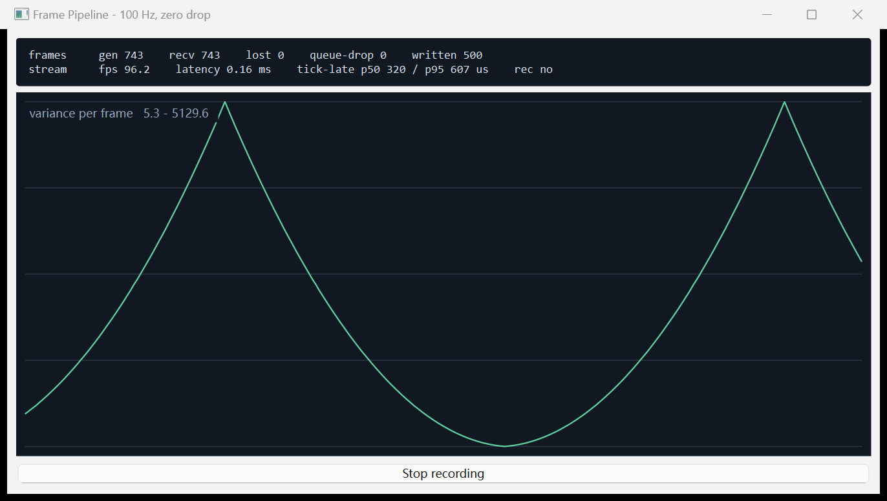

# realtime-frame-pipeline

A small Qt/C++ demo of the three things that decide whether a real-time acquisition system
survives contact with real hardware:

1. **A frame pipeline that does not drop frames** — 100 Hz, 512 KB per frame (~50 MB/s).
2. **A reusable high-precision scheduler** — register periodic tasks, measure the lateness of
   every tick, report it as a distribution instead of a flattering average.
3. **Frames that carry their own identity** — a 512-byte header with the frame index, so a
   missing frame is detectable at runtime and auditable offline.



> The frame source is synthetic. It stands in for a real capture link so this demo can be
> published at all — the work it mirrors is under NDA. Nothing in this repository is derived from
> client code.

---

## What the numbers on screen mean

| Field | Meaning |
|---|---|
| `gen` / `recv` | Frames produced by the timer thread / frames processed by the consumer |
| `lost` | Gaps in the frame-index sequence seen by the consumer — **the number that must stay 0** |
| `queue-drop` | Frames refused because the bounded queue was full (surfaced, never hidden) |
| `written` | Frames appended to the `.dat` log |
| `fps` | Actual sustained rate over the last sampling window |
| `latency` | Age of the frame just processed, from the producer's timestamp |
| `tick-late p50 / p95` | How late each scheduled tick actually fired, over the last 240 ticks |

`tick-late` is reported as p50 and p95 because a mean hides the tail. On a normal Windows
desktop the p50 sits in the low hundreds of microseconds and the p95 is a few times larger —
that is the operating system, not the pipeline. Which is exactly why the queue exists: 8 frames
of slack absorbs an 80 ms scheduling hiccup without losing a single frame.

---

## What it demonstrates

| Concern | Where it lives in the code |
|---|---|
| Producer/consumer decoupling | `produce()` on the timer thread, `consume()` on its own thread, joined by a bounded queue |
| No silent frame loss | A monotonic `frame_index` in every header; the consumer counts discontinuities |
| Bounded memory under overload | Queue capped at 8 frames; on overflow the drop is counted, not absorbed |
| Buffer reuse at line rate | Frames are recycled through a free list — allocating 512 KB per frame at 100 Hz costs page faults that land directly on the timing |
| Precise timing | `PrecisionTimer` schedules from the ideal deadline (`next += interval`), so late ticks do not accumulate drift |
| Trustworthy recordings | Header + payload appended to a `.dat` log, with index and checksum, so any file can be validated offline |

---

## Build

Requires Qt 5.15 or Qt 6 (Widgets) and CMake 3.16+. The code avoids APIs removed between Qt 5
and Qt 6, so it builds against either.

```bash
cmake -S . -B build -DCMAKE_BUILD_TYPE=Release
cmake --build build --config Release
```

Tested with Qt 6.9.2 (MinGW) on Windows 11.

**Use the MinGW that ships with your Qt installation.** Mixing in a different MinGW produces a
binary that links but dies on startup, because the C++ runtime is shared. With a standalone Qt
install that means `Qt/Tools/mingw1310_64`, not some other toolchain on `PATH`.

---

## Run

```bash
./realtime_frame_pipeline
./realtime_frame_pipeline --record     # start a 500-frame capture immediately
```

Press **Record** to write 500 frames to `frames.dat` (250 MB at 512 KB per frame). Release build
holds ~100 fps with `lost = 0`. A Debug build, or a machine under load, will start moving the
`queue-drop` and `lost` counters — that is the point: nothing fails silently.

### Validating a recording

The file is a plain concatenation of `512-byte header + 512 KB payload`, so it can be walked by
anything. The header layout is `FrameHeader` in `src/frame_pipeline.h`; the frame index sits 4
bytes in. A recording of 500 frames should show indices 0..499 with no gaps.

---

## Notes on Windows timing

Three things had to be measured rather than assumed, and all three changed the design:

1. **`timeBeginPeriod(1)` is not dependable.** It can be ignored or overridden by power policy and
   job objects. Relying on it silently turns a 10 ms schedule into a 15.6 ms one.
2. **Condition-variable waits cost more than they look.** `cv.wait_until` added roughly a
   millisecond per tick compared with `sleep_until` on this platform — measurable at 100 Hz.
3. **The fix is a high-resolution waitable timer.** `CreateWaitableTimerEx` with
   `CREATE_WAITABLE_TIMER_HIGH_RESOLUTION` is not tied to the 15.6 ms tick. Switching to it moved
   the isolated scheduler self-test from p50 = 7910 µs to p50 = 322 µs.

The thread also runs at `THREAD_PRIORITY_HIGHEST` for the duration of the run, which is what a
control loop would do — not a hard-real-time class, and not a substitute for hardware timestamping.

---

## Layout

```
src/precision_timer.h/.cpp  reusable scheduler, high-resolution wait
src/frame_pipeline.h/.cpp   frame header, bounded queue, producer, consumer, .dat log
src/main_window.h/.cpp      stats panel and a custom-painted variance chart
src/main.cpp                entry point
docs/screenshot.png         the image above
```

No third-party dependencies beyond Qt itself — the chart is a `QWidget` with a `paintEvent`.

---

## License

MIT. See [LICENSE](LICENSE).
